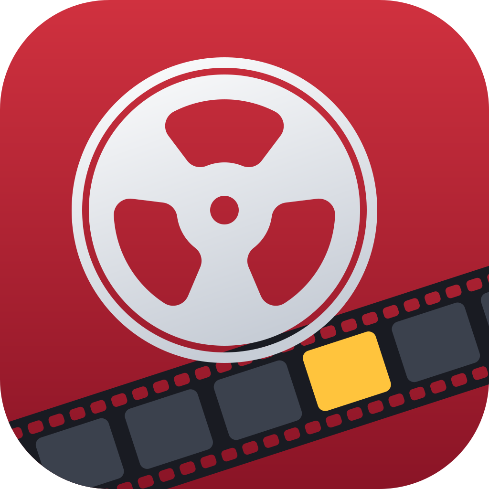

# Reel

A minimal macOS video player. It uses libmpv for playback, the same engine as IINA.

## Features

- The window opens at the size of the video. Large videos scale down to fit the screen.
- A double-click on the title bar toggles between "fill the screen" and the previous size.
- The title bar and the control bar sit above and below the video. They never cover it.
- Window resizes keep the video aspect ratio.
- When playback is paused, the control bar shows the frame number and the time in milliseconds. For MP4 and MOV files, the frame number is exact, also for variable frame rate screen recordings. For other files, mpv estimates it ("≈").
- mpv gets the display ICC profile, as in IINA. The profile updates when the window moves to another screen.

## Frame scrubbing

Reel borrows these tools from video editors for frame-accurate work on a paused video.

### Frame strip

When playback pauses, the window grows down and shows a row of frames under the control bar. The video keeps its size. When playback starts again, the window shrinks back.

- The middle frame, with the accent border, is the current frame.
- Move the pointer over a frame to see it in the video. Move the pointer off the strip to go back.
- Click a frame to go to it.
- Drag the strip like a ruler. Each frame width of the drag steps one frame.
- Scroll with the trackpad or the mouse wheel to step frames. One wheel notch is one frame.
- An orange tick marks a frame that differs from the frame before it. Screen recordings often have long runs of identical frames, and the ticks show where the picture changes.
- A yellow band marks the frames between the In mark and the Out mark.

For MP4 and MOV files, the strip shows frame numbers. For other files, it shows times.

### Precision scrubbing

Drag the playhead in the control bar, then move the pointer up or down, away from the bar. The scrub speed drops as the pointer moves farther away:

| Distance from the bar | Speed |
| --- | --- |
| Less than 40 points | Normal |
| 40 to 90 points | Half |
| 90 to 140 points | Quarter |
| More than 140 points | Fine (a fraction of a frame per point) |

The control bar shows the current speed during the drag.

### J, K, and L

- L plays forward at the playback speed. Each press doubles the speed, up to 16×.
- J plays backward. Each press doubles the speed, up to 16×.
- K stops.
- Hold K and tap J or L to step one frame.
- Hold K and hold J or L to play at quarter speed. Release a key to stop.

### Changes

⌥. goes to the next frame that differs from the frame before it. ⌥, goes to the previous such frame. Use these to skip runs of identical frames.

### In and Out marks

- I sets the In mark and O sets the Out mark.
- Playback loops between the marks.
- ⌥⌘C copies all frames from In to Out. Reel asks first when the range has more than 100 frames.
- The control bar shows the marks on the playhead track.

### Bookmark

- B sets the bookmark at the current frame. Playback does not stop.
- ⇧B goes to the bookmark and plays from there. It also starts playback when the video is paused.
- A new bookmark replaces the old one.
- A cyan flag marks the bookmark on the playhead track.

Use the bookmark to watch the start of a segment again and again.

## Playback speed

- ] plays faster and [ plays slower. The steps are 0.5×, 0.75×, 1×, 1.25×, 1.5×, 1.75×, 2×, 2.5×, 3×, and 4×.
- \ goes back to normal speed (1×).
- Playback > Speed lists all the steps.
- Space, L, J, and ⇧B play at the playback speed. Each L or J press doubles the speed from there, up to 16×. K goes back to the playback speed.
- Reel remembers the speed. New windows open at the last speed that you chose.
- While playback runs at a speed other than 1×, the speed shows under the window title.

## Control wheel

Hold the left Control key to open the control wheel under the pointer. Release the key to close it.

- The middle button plays or pauses.
- The buttons on the left go back, and the buttons on the right go forward. They skip 30 seconds, skip 5 seconds, or step one frame.
- The top button copies the current frame and 5 frames on each side.
- The bottom buttons set the playback speed. The tortoise is slower, the hare is faster, and the middle button shows the speed. Click the middle button to go back to 1×.
- Each button gets the full slice of the wheel in its direction. Move the pointer toward a button and click.
- The wheel stays open after a click, so you can click a button again and again.
- A key press or another modifier key closes the wheel, so Control shortcuts such as ⌃⌘F still work.

While the wheel is open, a Control-click does not open a context menu. A right-click still does.

## Keyboard shortcuts

| Key | Action |
| --- | --- |
| Space | Play or pause |
| ← / → | Back or forward 5 seconds |
| ⇧← / ⇧→ | Back or forward 30 seconds |
| , / . | Previous or next frame (pauses playback) |
| ⌥, / ⌥. | Previous or next change |
| J / K / L | Play backward, stop, play forward |
| K + J / K + L | Step one frame back or forward. Hold to play at quarter speed |
| I / O | Set the In mark or the Out mark |
| ⇧I / ⇧O | Go to the In mark or the Out mark |
| ⌥X | Clear the In and Out marks |
| B | Set the bookmark |
| ⇧B | Play from the bookmark |
| [ / ] | Slower or faster playback |
| \ | Normal playback speed |
| ⌘C | Copy the current frame |
| ⇧⌘C | Copy the current frame and 5 frames on each side |
| ⌥⌘C | Copy the frames from In to Out |
| ⌃⌘F | Full screen |
| Left Control (hold) | Control wheel |

The control bar has buttons for play, the 5 and 30 second skips, the frame steps, and ⇧⌘C. The Playback menu lists all the commands.

## Copying frames

The copy commands pause playback and save each frame as a full-resolution PNG. Each frame becomes one clipboard item, with the PNG data and the file:

- Finder pastes the PNG files.
- Image apps (Slack, Figma, Preview) paste the images.

The file names include the frame number, for example `recording-f00573.png`. The files stay in `~/Library/Caches/com.gstark.Reel/Frames/`. Reel removes folders older than one day.

## Libraries

Reel gets libmpv and FFmpeg from the [MPVKit](https://github.com/mpvkit/MPVKit) Swift package. The package has prebuilt static libraries, so the app has no external dylibs. The build uses the LGPL product of MPVKit.

`project.yml` sets one exact MPVKit version. To move to the newest MPVKit release:

```sh
just update-dependencies         # newest release
just update-dependencies 1.0.0   # a specific MPVKit tag
```

The script writes the version into `project.yml`, regenerates the project, and resolves the package. It prints the link to the release notes. MPVKit marks its FFmpeg update builds (for example `1.1.0-n9.0.2`) as prereleases. The script includes them.

The FFmpeg build in MPVKit has no image encoders. Reel writes the PNG files with ImageIO.

## Build and install

Requirements: Xcode, XcodeGen (`brew install xcodegen`), just, and network access for the first package download.

```sh
just install   # builds Release and installs /Applications/Reel.app
```

`just install` also makes Reel the default app for 62 video file extensions. It leaves out `.ts` and `.mts`, because TypeScript files use those extensions. It also does not change a video type that claims one of them. macOS uses one type for `.mts` and `.m2ts`, so `.m2ts` files keep their current app. macOS asks you to confirm each change, so the first install shows one prompt per type. Later installs change only types that do not open in Reel yet, so they ask nothing. To change this, use Finder: Get Info > Open with > (an app) > Change All. To add an extension, add it to the "Video files" document type in `project.yml`. If macOS does not declare a type for the extension, also add it to `com.gstark.reel.video`.

For development, run `xcodegen generate` and open `Reel.xcodeproj`.

## Homebrew release

`just homebrew` publishes a release:

1. It stops if the working tree has changes.
2. It builds Release with the version `MARKETING_VERSION-yyyyMMddHHmm`.
3. It pushes the branch and creates a GitHub release in `gstark/reel` with the zipped app.
4. It writes `Casks/reel.rb` in the `gstark/tap` tap, then commits and pushes it.

Install with `brew install gstark/tap/reel`.
